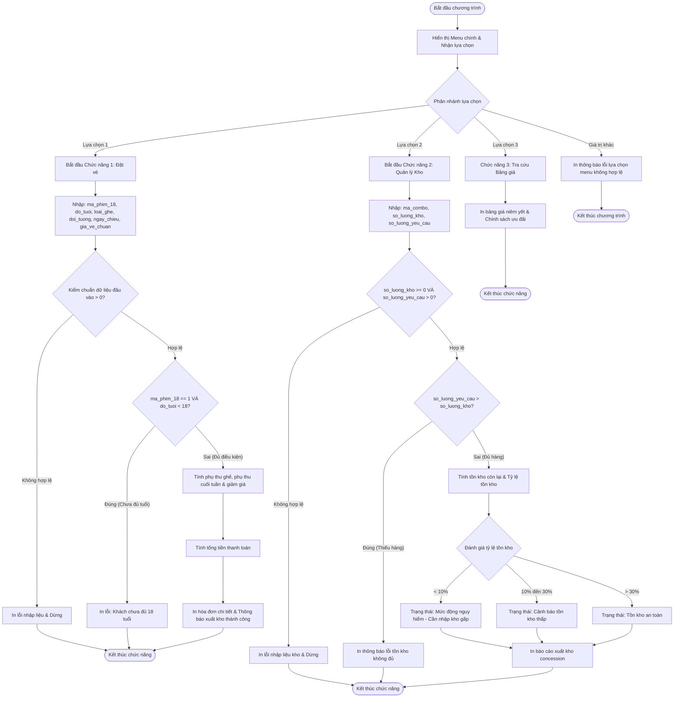

# BÁO CÁO BÀI TẬP LẬP TRÌNH C: XÂY DỰNG MODULE QUẢN LÝ KHO VÉ VÀ TÍNH GIÁ VÉ RẠP PHIM CGV-LOTTE

> 👤 **Học viên:** Hoàng Công Dũng | **Mã SV:** PTIT-HCM-009
> 🏫 **Môn học:** it102-rl-hoangcongdung

---

## 📊 Sơ đồ thiết kế hệ thống (Activity Diagram)

> 💡 *Sơ đồ dưới đây được render tự động trực tiếp trên GitHub bằng Mermaid. Bạn cũng có thể tải file **`bt4.drawio`** trong repository này để mở và chỉnh sửa trực tiếp trên [Draw.io (diagrams.net)](https://app.diagrams.net).* 

---

## Nhiệm vụ 1: Phân tích yêu cầu và Thiết kế giải thuật

Bài thực hành yêu cầu xây dựng chương trình C mô phỏng hệ thống kiosk tự động tại các rạp chiếu phim CGV và Lotte, xử lý đồng thời hai nghiệp vụ cốt lõi: phân luồng đặt vé xem phim có kiểm soát độ tuổi, phụ thu, giảm giá và quản lý kho vật tư bắp nước concession.

Toàn bộ chương trình được thiết kế chạy tuần tự qua menu điều hướng 'switch-case' kết hợp cấu trúc rẽ nhánh 'if - else if - else' chuẩn ANSI C/C11, tuân thủ tuyệt đối quy tắc không sử dụng vòng lặp hay mảng.

- Kiểm tra nghiêm ngặt bẫy dữ liệu đầu vào: độ tuổi > 0, giá vé > 0, tồn kho >= 0 và số lượng mua > 0.
- Xử lý logic bẫy độ tuổi C18: Khán giả dưới 18 tuổi xem phim 18+ sẽ bị chặn ngay lập tức và hủy giao dịch xuất kho.
- Tính toán chính xác phụ thu ghế VIP/Couple, phụ thu cuối tuần 10% và chính sách giảm giá học sinh sinh viên 20% chỉ áp dụng vào ngày thường.

## Nhiệm vụ 2: Bảng đặc tả quy trình nghiệp vụ hệ thống

Dưới đây là bảng phân tích logic chi tiết các chức năng xử lý trong chương trình:

| Chức năng | Điều kiện nghiệp vụ | Công thức / Xử lý kỹ thuật | Trường hợp ngoại lệ (Edge Case) |
| --- | --- | --- | --- |
| Menu 1: Đặt vé | ma_phim_18 == 1 và do_tuoi < 18 | Báo lỗi và kết thúc ngay lập tức | TUYET DOI CAM: Khách hàng chưa đủ 18 tuổi |
| Menu 1: Đặt vé | Phụ thu ghế & cuối tuần | phu_thu_ghe + (gia_ve * 0.10) | Ghế thường 0đ, VIP 15k, Couple 30k |
| Menu 1: Đặt vé | Giảm giá học sinh sinh viên | giam_gia = gia_ve * 0.20 | Chỉ áp dụng khi ngay_chieu == 1 (Ngày thường) |
| Menu 2: Kho bắp | so_luong_yeu_cau > so_luong_kho | In cảnh báo thiếu hàng và dừng | LOI: Tồn kho không đủ cung ứng |
| Menu 2: Kho bắp | Đánh giá tỷ lệ tồn kho | ty_le = (con_lai / kho_ban_dau) * 100 | Nguy hiểm (<10%), Cảnh báo (10-30%), An toàn (>30%) |
| Menu 3 & Khác | Lựa chọn menu không hợp lệ | In thông báo mặc định | Loi: Lua chon menu khong hop le! |

## Nhiệm vụ 3: Đóng góp Mã nguồn hoàn chỉnh (main.c)

Mã nguồn được viết sạch sẽ, sử dụng tên biến tiếng Việt không dấu rõ nghĩa, biên dịch hoàn toàn sạch lỗi cảnh báo với 'gcc -Wall main.c -o main'.

---

## 📁 Danh sách tệp tin nộp bài trong Repository
- 📝 `bt4.docx`: Báo cáo tài liệu phân tích nghiệp vụ hoàn chỉnh.
- 🎨 `bt4.drawio`: File thiết kế sơ đồ chuẩn theo quy định đề bài (mở trực tiếp bằng [Draw.io](https://app.diagrams.net) hoặc Lucidchart).
- 💻 `main.c`: Mã nguồn chương trình.
